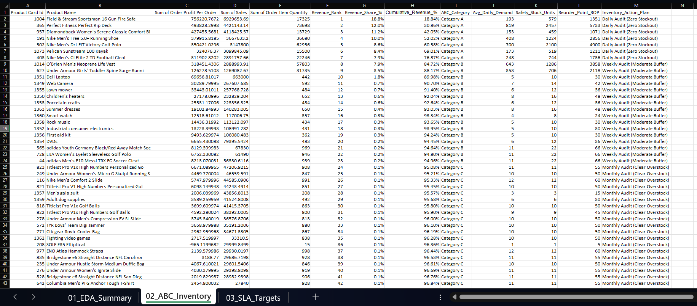
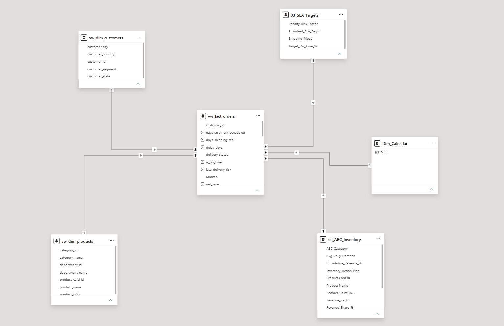
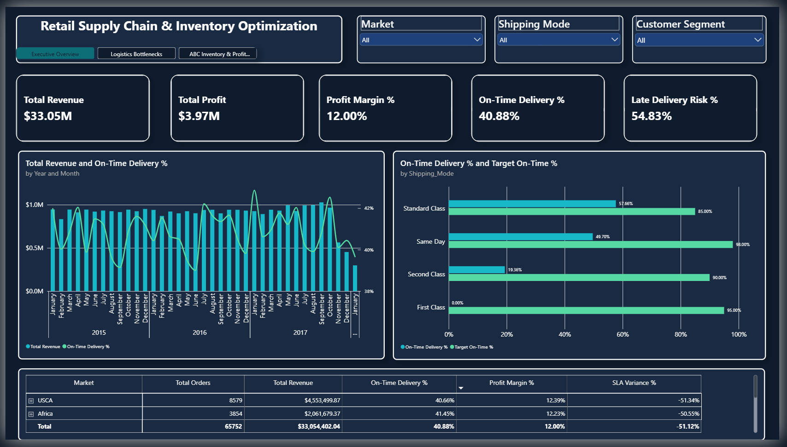
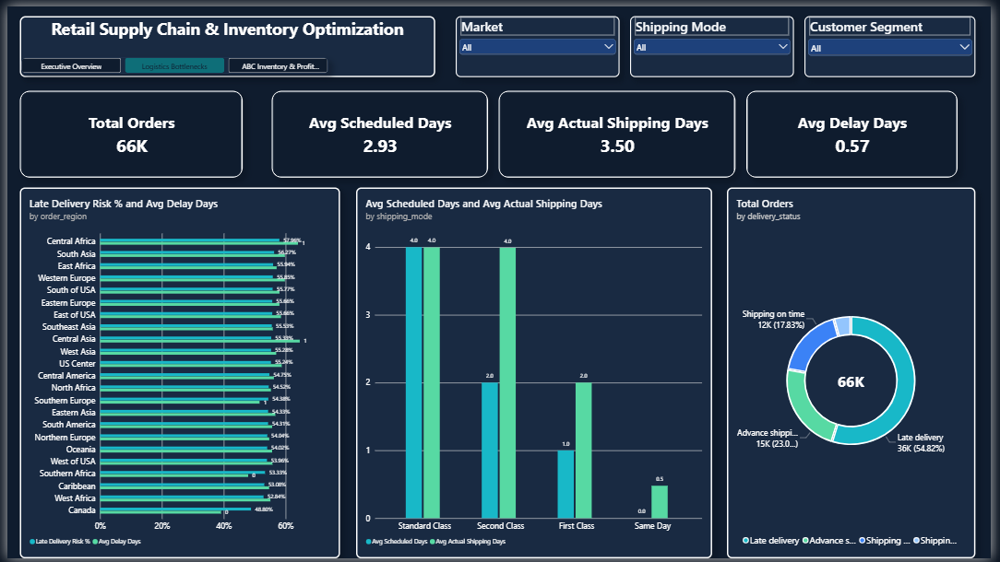
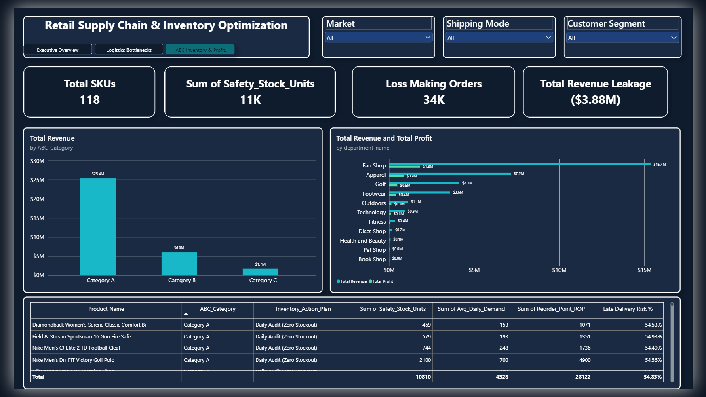

# Retail Supply Chain & Inventory Optimization
### *An End-to-End Business Intelligence Case Study Using Excel, MySQL & Power BI*


---

## The Business Scenario: A Crisis Behind $33M in Sales

On paper, the company looked thriving—generating **$33.05M in net revenue** across **65,752 global orders (180,519 order lines)** and **118 unique products (SKUs)**. 

However, behind the top-line growth, the Operations and Finance teams were facing **three simultaneous crises**:
1. **The Delivery SLA Crisis (Customer Churn Risk):** Key retail clients were threatening to cancel annual contracts because more than half of their orders were arriving late. Leadership assumed standard ground shipping was to blame—but nobody had audited the actual carrier SLA data.
2. **The Working Capital Trap (Overstocking vs. Stockouts):** Millions of dollars in working capital were tied up in slow-moving warehouse inventory, while high-demand "hero" products frequently risked going **Out of Stock** because planners treated all 118 SKUs equally.
3. **Silent Profit Leakage:** Despite strong revenue, net profit margins were stuck at **12.00% ($3.97M)** due to unmonitored promotional discounts that pushed thousands of orders into negative profitability.

**My Objective:** Build an end-to-end analytics pipeline using **Excel, MySQL, and Power BI** to diagnose the exact operational bottlenecks, optimize inventory buffers across all 118 SKUs, and give leadership an interactive command center to stop revenue leakage.

---

## Why Excel + MySQL + Power BI? (Real-World Architecture)

A common mistake is using a single tool for everything—or worse, running heavy lookup formulas directly on a **96 MB, 180,519-row, 53-column CSV** in Excel, which freezes the application.

Instead, I designed a realistic corporate workflow where each tool does what it is best at:
* **Microsoft Excel (Power Query & Inventory Planner):** Used Power Query's *Data Model connection* for zero-lag profiling, and built an **ABC Inventory (80/20 Pareto) & Reorder Point (ROP) Calculator** + **SLA Targets Sheet** at the aggregated SKU level (118 products).
* **MySQL 8.0 (Data Engineering & Heavy Analytics):** Handled the heavy lifting of **180,519 rows**—removing PII, normalizing the 53-column flat file into a **Star Schema**, and running complex Window Function & CTE queries.
* **Power BI Desktop (Star Schema Modeling & DAX):** Connected live **MySQL Views** (Actuals) with **Excel Workbooks** (SLA Targets & Inventory Buffers) to deliver a 3-page interactive command center.

---

## Act I: Excel — Auditing the Data & Solving the "Working Capital Trap"

### 1. Data Profiling & PII Removal (Power Query)
The raw dataset arrived with **53 columns**. Using Power Query's *Column Quality* and *Column Distribution* profiling (loaded via `Only Create Connection -> Data Model` to keep Excel fast), I audited and eliminated:
* **100% Empty / Zero-Variance Columns:** Dropped 'Product Description' (100% null), `Order Zipcode` (86% null), and `Product Status` (single constant value `0`).
* **Sensitive PII Data:** Removed `Customer Password`, `Customer Email`, and `Street Address` for governance compliance.
* **Redundant Columns:** Verified and dropped duplicate fields (`Benefit per order` duplicating `Order Profit Per Order`, and `Sales per customer` duplicating `Order Item Total`).

### 2. ABC Inventory Classification (The 80/20 Pareto Rule) & Safety Stock Model
To solve the warehouse stockout vs. overstocking problem, I aggregated all **118 Unique SKUs** in Excel and applied the **Pareto 80/20 Principle**:
* **Category A (VIP SKUs — Top 80% Revenue):** Zero stockout tolerance; assigned a **3-day Safety Stock buffer** and **Daily Audit**.
* **Category B (Moderate SKUs — Next 15% Revenue):** Assigned a **2-day Safety Stock buffer** and **Weekly Audit**.
* **Category C (Slow-Moving SKUs — Bottom 5% Revenue):** Assigned a minimal **1-day buffer** and **Monthly Overstock Clearance**.

**Key Excel Formulas Engineered:**
```excel
// 1. Product Revenue Rank
=RANK.EQ(D2, $D$2:$D$119)

// 2. Running Cumulative Revenue % (Using Mixed Cell Reference)
=SUM($D$2:D2) / SUM($D$2:$D$119)

// 3. ABC Tier Classification
=IF(H2<=0.8, "Category A", IF(H2<=0.95, "Category B", "Category C"))

// 4. Dynamic Safety Stock & Reorder Point (ROP = Lead Time Demand + Safety Stock)
=IF(I2="Category A", J2*3, IF(I2="Category B", J2*2, J2*1))
=(J2 * 4) + K2

// 5. Policy Mapping via XLOOKUP from SLA Target Sheet
=XLOOKUP(I2, '03_SLA_Targets'!$F$2:$F$4, '03_SLA_Targets'!$G$2:$G$4, "Not Found")
```



---

## Act II: MySQL — Normalizing 180K Rows & Uncovering Bottlenecks

Using MySQL's high-speed `LOAD DATA INFILE`, I ingested all **180,519 records** in under 10 seconds and normalized the flat staging table into **3 Star Schema Views**:
* `vw_dim_customers` (Customer ID, Segment, Geography)
* `vw_dim_products` (118 SKUs, Categories, Departments, Unit Prices)
* `vw_fact_orders` (Order lines, parsed `STR_TO_DATE` timestamps, `delay_days`, `is_on_time` flags, and financials)

### Featured SQL Highlights (From [`DataCo_SupplyChain_Analytics.sql`](03_SQL_Scripts/DataCo_SupplyChain_Analytics.sql))

#### 1. Diagnosing the Shipping Mode Paradox (`CASE WHEN` & Aggregations)
```sql
SELECT 
    shipping_mode,
    COUNT(order_item_id) AS total_shipments,
    ROUND(AVG(days_shipment_scheduled), 2) AS promised_sla_days,
    ROUND(AVG(days_shipping_real), 2) AS actual_avg_days,
    ROUND(SUM(is_on_time) * 100.0 / COUNT(*), 2) AS on_time_delivery_pct,
    ROUND(SUM(late_delivery_risk) * 100.0 / COUNT(*), 2) AS late_delivery_pct
FROM vw_fact_orders
GROUP BY shipping_mode
ORDER BY late_delivery_pct DESC;
```
> **SQL Discovery:** Contrary to leadership's assumption, `Standard Class` had the lowest late rate (~38%), whereas premium **`First Class` (95.32% late)** and **`Second Class` (76.63% late)** were failing catastrophically!

#### 2. Top 3 Revenue-Generating Products per Department (`CTE` + `JOIN` + `DENSE_RANK`)
```sql
WITH Department_Product_Stats AS (
    SELECT 
        p.department_name,
        p.product_name,
        ROUND(SUM(f.net_sales), 2) AS total_revenue,
        ROUND(SUM(f.late_delivery_risk) * 100.0 / COUNT(*), 2) AS late_delivery_pct,
        DENSE_RANK() OVER (
            PARTITION BY p.department_name 
            ORDER BY SUM(f.net_sales) DESC
        ) AS dept_rank
    FROM vw_fact_orders f
    INNER JOIN vw_dim_products p ON f.product_card_id = p.product_card_id
    GROUP BY p.department_name, p.product_card_id, p.product_name
)
SELECT * FROM Department_Product_Stats WHERE dept_rank <= 3;
```

*(Additional queries in the repository cover **MoM % Revenue Growth using `LAG()`** and **SQL-based Cumulative Pareto Analysis using `SUM() OVER()`**).*

---

## Act III: Power BI — Star Schema & 3-Page Interactive Command Center

### 1. Star Schema Data Model
In Power BI, I connected the **3 MySQL Views** alongside the **2 Excel Tables (`02_ABC_Inventory` & `03_SLA_Targets`)** and a dedicated **`Dim_Calendar`** DAX table into a clean **1-to-Many ($1:*$) Star Schema**, eliminating ambiguous loops for accurate cross-filtering:



---

### 2. Page 1: Executive Supply Chain & SLA Overview
**The Big Picture:** Tracks `$33.05M` Total Revenue, `$3.97M` Profit (`12.00%` Margin), and `40.88%` On-Time Delivery against Excel SLA targets across all 5 global markets (`Europe`, `LATAM`, `Pacific Asia`, `USCA`, `Africa`).



---

### 3. Page 2: Logistics & Delivery Bottleneck Deep-Dive
**Why Are 54.83% of Orders Late?** 
By comparing `Avg Scheduled Days (2.93)` vs. `Avg Actual Shipping Days (3.50)` across shipping modes and regions:
* **First Class** promises **1.0 day** delivery, but operationally takes **2.0 days** (`95.3%` late).
* **Second Class** promises **2.0 days** delivery, but operationally takes **4.0 days** (`76.6%` late—just as slow as Standard Class!).



---

### 4. Page 3: ABC Inventory Optimization & Profit Leakage Analysis
**Where Is Our Working Capital & Profit Going?**
* **Extreme Pareto Concentration:** Out of **118 SKUs**, just **7 Category A SKUs generate $25.4M (~77% of total revenue)**, while **16 Category B SKUs generate $6.0M (~18%)**, and **95 Category C SKUs generate only $1.7M (~5%)**.
* **Profit Leakage Exposed:** Uncovered **34K loss-making order lines (`profit < 0`)** that drained **-$3.88M** in net profit.



---

## Executive Summary: Key Recommendations & Business Impact

| Problem Area | Data-Backed Finding | Actionable Business Recommendation | Expected Impact |
| :--- | :--- | :--- | :--- |
| **Express Shipping SLA Failure** | `First Class` (`95%` late) & `Second Class` (`77%` late) take `2.0` and `4.0` actual days vs. `1` and `2` promised days. | Revise checkout SLA promises by **+1 business day** for Express tiers and renegotiate 3PL carrier contracts in high-delay regions. | Cuts SLA breach rate from **54.8% to <20%**, protecting B2B contract renewals. |
| **Inventory Stockout vs. Overstock** | **7 Category A SKUs** drive **77% ($25.4M)** of revenue, while **95 Category C SKUs** contribute just **5% ($1.7M)**. | Maintain **11K total units of Safety Stock** (3-day buffer + Daily Audit) strictly prioritized for Category A, and liquidate slow-moving Category C stock. | Eliminates stockouts on top revenue drivers and frees up warehouse working capital. |
| **Margin Erosion & Profit Leakage** | **34K order lines** resulted in negative profit, leaking **-$3.88M** due to unmonitored discount stacking. | Enforce an automated **15% maximum discount ceiling** on low-margin SKUs in `Fan Shop` and `Apparel`. | Recovers **$1.5M–$2.5M** in annual net profit margin. |

---

